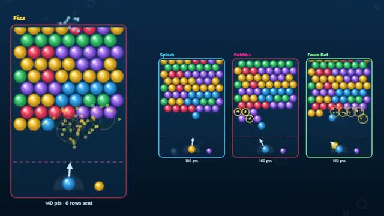

# Bubble Pop

Pop bubbles, drop clusters, flood your rivals. A multiplayer starter game from [Multiplayer Agent](https://multiplayeragent.com): 2D, versus, 2–4 players, with bots that fill empty seats.

## How it plays

Aim the launcher and shoot: 3 of a color pop, and anything left hanging falls. Drop 3 or more and a rival gets an extra row pushed in from the top. A bubble past the line is out; last board standing wins.

**Controls:** Mouse to aim, click to shoot, right-click or Shift to swap; on touch, drag to aim and let go.

## Make it yours in the Game Builder

Open the [Game Builder](https://multiplayeragent.com), choose **Start from a starter game** and pick Bubble Pop. It opens as version 1 in your studio, ready to play and publish. Then ask for changes, for example:

- Add a bomb bubble that pops everything around it
- Make it underwater with fish instead of bubbles
- Add a co-op mode where we share one big board

## Run it yourself

1. Get a free publishable key (`pk_…`) at [multiplayeragent.com](https://multiplayeragent.com).
2. In `index.html`, put it in place of `pk_REPLACE_ME` in the `MP_CONNECT` block.
3. Open `index.html` in a browser. No build step and no server needed.

Without a key it still runs, offline against bots.

## How it is built

- One `index.html`. The comment at the top of the script maps the code and explains the multiplayer.
- Every bubble and effect is drawn in code on a canvas; there are no image files.
- **Live sync:** Every rival's board, aim and shots play out next to yours.
- **Host-run rounds:** The host's browser runs the match: who is out, the winner and the restart. If it leaves, the next player takes over.
- **Bots:** Bots fill empty seats: they line up shots and go for big drops.
- **Leaderboard:** Each player's best score in one match.
- `?attract` runs it offline with bots only. The preview video is recorded from it.

## License

MIT.
